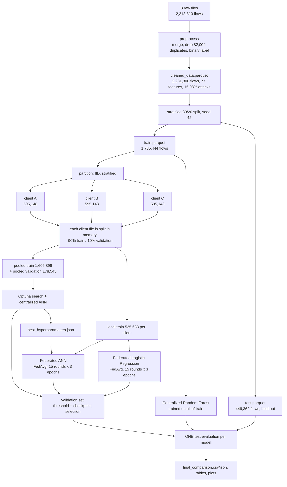

# How the project works

**Privacy-Preserving Federated Learning Framework for Collaborative Malware Detection Across Organizations**

Binary network-intrusion detection (Benign = 0, Attack = 1) on CICIDS2017. Three simulated organizations
(clients A, B, C) train one shared model with FedAvg (Flower) without exchanging their training data. The
federated models are compared with centralized models trained on the pooled data, all on the same held-out
test set.

## 1. Run everything with one command

```bash
source venv/bin/activate          # once per terminal
python run_project.py             # run what is missing, then reports and tests
```

The default run is **safe and resumable**. A stage whose output files already exist is skipped, so the held-out test
set is never evaluated a second time by accident. The report stages and the test suite run every time (about 13 s
on the saved results).

| Command | What it does |
|---|---|
| `python run_project.py` | Resume: run missing stages, then reports + tests |
| `python run_project.py --dry-run` | Show the plan (what would run or be skipped), run nothing |
| `python run_project.py --list` | List the stages and typical durations |
| `python run_project.py --only reports` | Run selected stages (comma-separated keys) |
| `python run_project.py --skip-tests` | Skip pytest |
| `python run_project.py --verbose` | Show every line of the long training stages |
| `python run_project.py --force --yes` | Redo **every** stage from scratch (see section 7) |
| `python run_project.py --keep-going` | Continue after a failed stage |

What you get:

- **Terminal:** environment check, data on disk, the plan, one banner per stage with its output, a stage summary table
  and the final test-set comparison table.
- **`results/run_report.md`:** the same stage summary and results table as Markdown.
- **`logs/run_<timestamp>/<stage>.log`:** the complete output of every stage.

## 2. The stages

| Key | Stage | Reads | Writes | Test set? |
|---|---|---|---|---|
| `preprocess` | Merge the 8 raw files, drop duplicates, binary label | `dataset/raw/*.parquet` | `dataset/cleaned_data.parquet` | no |
| `eda` | Class-distribution summary | cleaned + raw files | `graphs/label_distribution.png` | no |
| `rf` | Create the 80/20 split, train the Random Forest, evaluate it | `cleaned_data.parquet` | `train.parquet`, `test.parquet`, `models/rf_baseline.joblib`, `results/centralized_rf_metrics.json`, RF plots | **once** |
| `partition` | Split `train.parquet` into three IID clients | `train.parquet` | `client_A/B/C.parquet` | no |
| `optuna` | 40-trial search, retrain the best ANN, evaluate it | client files (pooled) | `results/best_hyperparameters.json`, `results/optuna/*`, `models/ann_centralized_tuned/`, `results/ann_centralized_metrics.json` | **once** |
| `fed-lr` | Federated Logistic Regression, 15 rounds x 3 local epochs | client files | `results/federated_logistic_regression_validation_rounds.json`, `models/federated/logistic_regression/{best,latest}.pt` | no |
| `fed-ann` | Federated ANN (architecture from the Optuna result) | client files, `best_hyperparameters.json` | `results/federated_ann_validation_rounds.json`, `models/federated/ann/{best,latest}.pt` | no |
| `eval-lr` | Pick a threshold on validation, evaluate the federated LR | `models/federated/logistic_regression/best.pt` | `results/lr_federated_test_metrics.json` | **once** |
| `eval-ann` | Same for the federated ANN | `models/federated/ann/best.pt` | `results/ann_federated_test_metrics.json` | **once** |
| `reports` | Tables, convergence tables, plots, diagrams | saved result files | `results/final_comparison.csv/.json`, `graphs/*.png` | reads saved results only |
| `tests` | pytest (80 tests, synthetic data) | - | - | never |

Durations measured on the author's Mac (from the saved logs): Random Forest about 2 min, Optuna search about 47 min
plus about 1.5 min retrain, federated ANN about 2.5 min, federated LR about 25 s.

## 3. Data flow



The same flow as plain text:

```
raw (8 files, 2,313,810)
  -> cleaned (2,231,806)            preprocess
  -> train (1,785,444) | test (446,362, held out)      stratified 80/20
train -> Random Forest (all rows)                       centralized baseline
train -> client A | B | C (595,148 each)                IID partition
each client -> local train (535,633) + validation slice (~59,515)     in memory, stratified
pooled train/validation -> Optuna -> tuned centralized ANN
local train -> federated LR and federated ANN (FedAvg)
validation -> threshold choice + best-round choice      never the test set
test -> one evaluation per model                        RF, centralized ANN, federated LR, federated ANN
saved results -> comparison table + plots
```

## 4. How each model is trained

**Centralized Random Forest** (`centralized/`). 200 trees, balanced class weight, trained on all of `train.parquet`
without scaling. It has no validation split, so it uses the fixed threshold 0.5.

**Centralized ANN** (`core/`). A feed-forward network (Linear, optional BatchNorm, ReLU, Dropout per hidden layer, one
output logit) trained with `BCEWithLogitsLoss`. Optuna samples the architecture and training settings and maximizes the
validation PR-AUC of the attack class; weak trials are pruned. The best trial (#14: hidden layers [312, 289, 201],
AdamW, batch size 2048, no BatchNorm) is retrained and saved. `config.yaml` is never modified by the search; the result
is stored in `results/best_hyperparameters.json`.

**Federated training** (`federated/`). One communication round:

1. The server sends the global weights to clients A, B and C.
2. Each client trains for 3 epochs on its own training rows, with its own scaler.
3. Each client returns its updated weights and its number of training samples.
4. The server averages the weights, weighted by sample count (FedAvg). BatchNorm statistics, if a model had any, are
   combined on a separate path as pooled statistics.
5. The server scores the new global model on the combined validation set and saves `latest.pt`, and `best.pt` when
   the validation PR-AUC improves.

This repeats for 15 rounds. In the saved run the best federated ANN round was round 14.

**Scaling without sharing rows.** Every client fits a `StandardScaler` on its own training rows. For validation and for
the final test evaluation the server combines the clients' (sample count, mean, variance) into one scaler. This is
mathematically the scaler that pooling all training rows would give, but only those statistics are shared.

**Thresholds and the final evaluation.** For the ANN and LR models the decision threshold is chosen on validation data
(maximizing attack-class F1) and then applied unchanged to the test set. The Random Forest uses 0.5.

## 5. Why the test set is safe

- The test set is read only by `centralized.train_rf`, `core.optuna_search --final-test` and
  `core.evaluate --final-test`. Each refuses to run if that model's result file already exists, unless
  `--overwrite` is given.
- Tuning, threshold selection and checkpoint selection use validation data only.
- `train.parquet` and `test.parquet` are never re-split once they exist.
- The test suite contains a trap that fails if any training, tuning or threshold code touches `test.parquet`.
- Centralized and federated runs use exactly the same training and validation rows.

## 6. Where things end up

```
dataset/        parquet data (not in git)
models/         trained models and checkpoints (not in git)
results/        metrics JSON, comparison tables, Optuna trial log, run_report.md
graphs/         plots and design diagrams
logs/           one folder per run_project.py run
```

## 7. Redoing everything from scratch

`python run_project.py --force --yes` re-runs every stage with its overwrite flag. Be aware of what that means:

- Models are retrained **and evaluated on the held-out test set again**. The project's protocol is one test
  evaluation per model, so use `--force` only deliberately (for example after fixing a bug), never to compare
  alternatives on the test set.
- The Optuna search resumes from its saved database (`results/optuna/ann_centralized.db`); with 40 finished trials it
  runs no new trials and only redoes the final retrain and test evaluation. To search again, delete that database first.
- It takes roughly an hour: the original 40-trial search alone took about 47 minutes.
- A from-scratch run on another machine needs the 8 raw files in `dataset/raw/` (see the README) and the
  packages in `requirements.txt`.

## 8. The dashboard and the Live test backend

The React dashboard in `frontend/` shows the results of the pipeline. Its data (`frontend/src/data/*.json`) is exported from
`results/` and `dataset/` by `npm run data` (read-only), so five pages work without Python.

The **Live test** page talks to a small API, `backend/main.py` (FastAPI), which loads the saved models
(`models/rf_baseline.joblib` and the three `best.pt` checkpoints, each with its own scaler and the threshold chosen on validation data).

```bash
source venv/bin/activate
uvicorn backend.main:app --port 8000        # terminal 1: API (docs at http://localhost:8000/docs)
cd frontend && npm run dev                  # terminal 2: UI at http://localhost:5173, /api is proxied to port 8000
```

| Endpoint | What it does | Time |
|---|---|---|
| `POST /api/predict` | scores one flow (a sample id or edited feature values) with the four models | ms |
| `POST /api/predict-batch` | scores the 40 sample flows in `backend/demo_samples.json` | ms |
| `POST /api/quick-eval` | scores N random validation rows (scores cached per N and seed; thresholds adjustable) | seconds |
| `POST /api/predict-rows` | scores up to 2,000 uploaded rows (CSV in the UI) | ms–s |
| `POST /api/jobs` | background job: `tests` (pytest) or `federated` (1–5 FedAvg rounds into `backend/.runtime/`) | 3 s / 10–25 s |
| `GET /api/jobs/{id}` | status, log, live per-round progress (`rounds_live`) and result of a job | ms |
| `POST /api/jobs/{id}/stop` | stops a running job (and its Ray workers) | ms |
| `GET /api/history`, `DELETE /api/history` | finished runs kept in `backend/.runtime/history.json` | ms |
| `GET /api/comm` | values and bytes exchanged per round and the rows kept on each client, computed from the models and client files | ms |

The **Training monitor** reads the progress of a run from `FEDLOG {json}` lines that `federated/server.py` prints after each aggregation and each
validation (logging only; training and the saved results are unchanged). The round animation replays those real events one after another so
that fast rounds stay visible; it shows no step that did not happen.

Safety: the held-out test set is never scored in bulk by the API (the one-time evaluation stays in `results/`), mini federated runs write
only to `backend/.runtime/` (git-ignored), and the sample flows are single-row demonstrations. To rebuild the sample file run
`python backend/export_samples.py`.

## 9. Troubleshooting

| Message | Cause and fix |
|---|---|
| `Missing packages: [...]` | The virtual environment is not active. Run `source venv/bin/activate`, or `pip install -r requirements.txt`. |
| `BLOCKED: missing input: ...` | A stage's input file does not exist, for example the raw files. The run stops there; fix the input and re-run. |
| `... already exists (test set already evaluated)` | Expected protection. Use the default mode, which skips finished stages. |
| A stage failed | The error is in the terminal and the full output in `logs/run_<timestamp>/<stage>.log`. |
| Live test page says the backend is not running | Start it: `source venv/bin/activate && uvicorn backend.main:app --port 8000`, then reload the page. |
| `Address already in use` on port 8000 | Another backend is running; stop it (`pkill -f "uvicorn backend.main"`) or use `--port 8001` and change the proxy in `frontend/vite.config.js`. |
| Live test: a model is missing / 503 | `models/` has not been created yet; run `python run_project.py`. |
